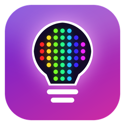
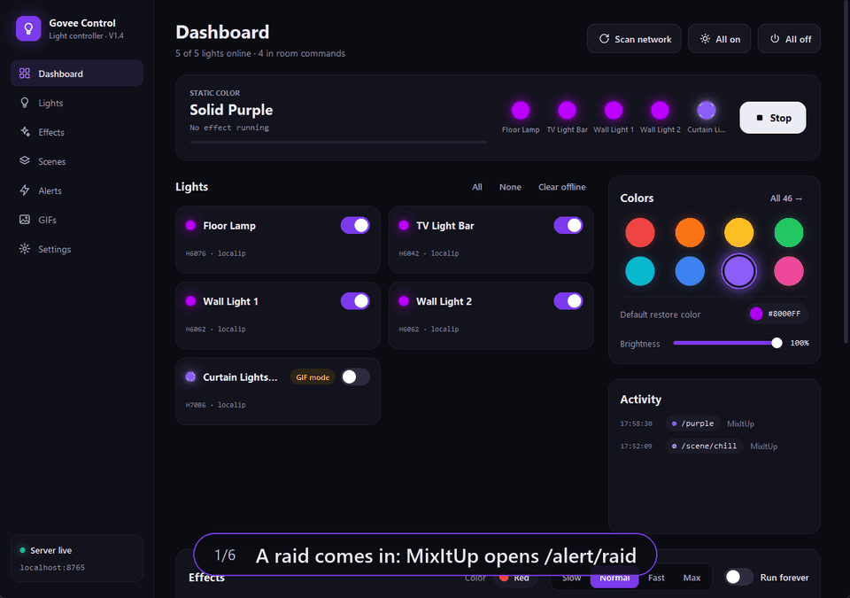
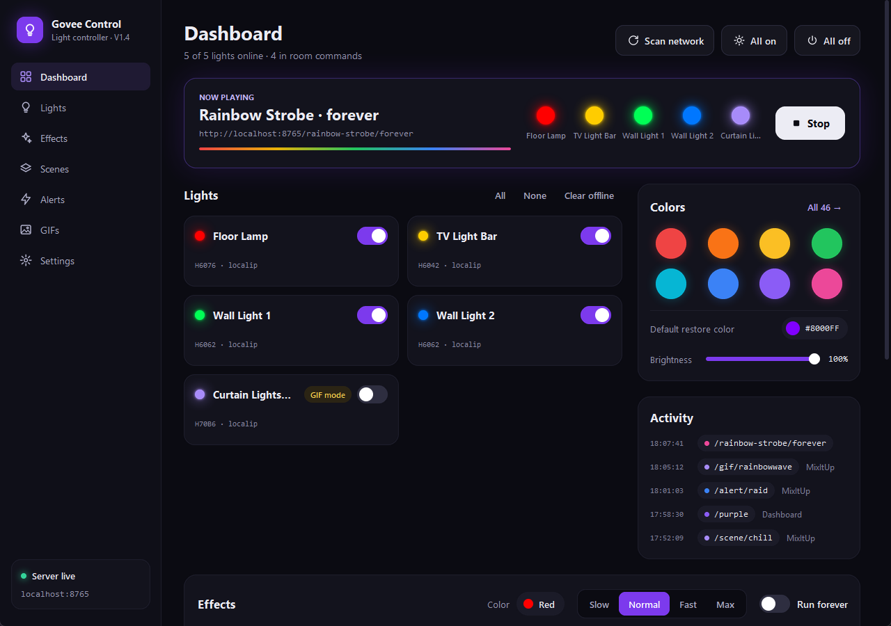
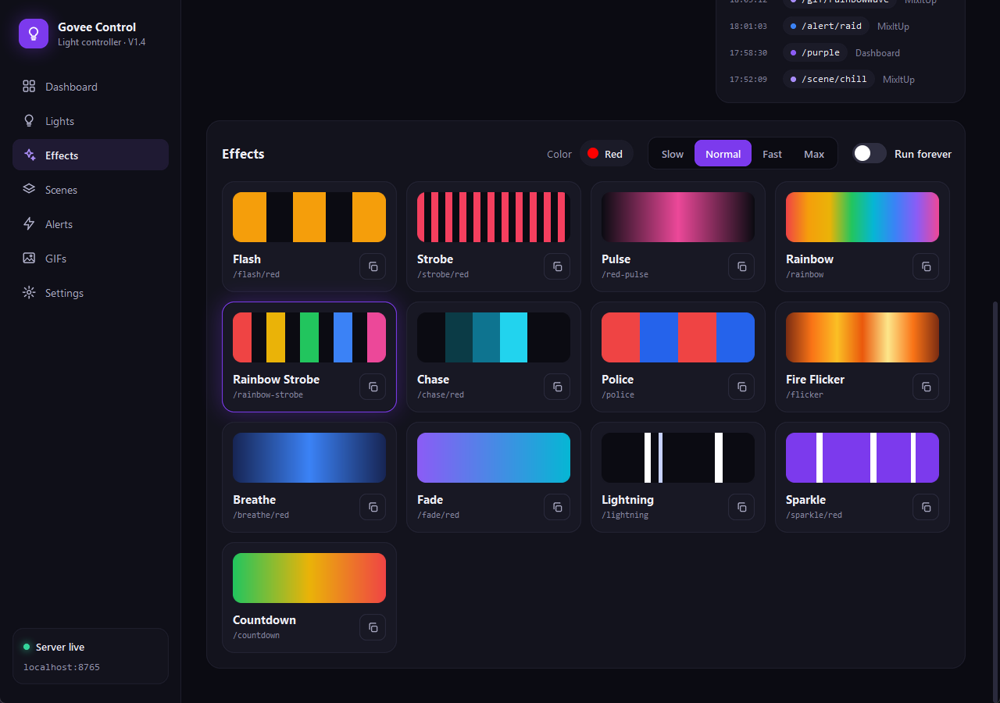
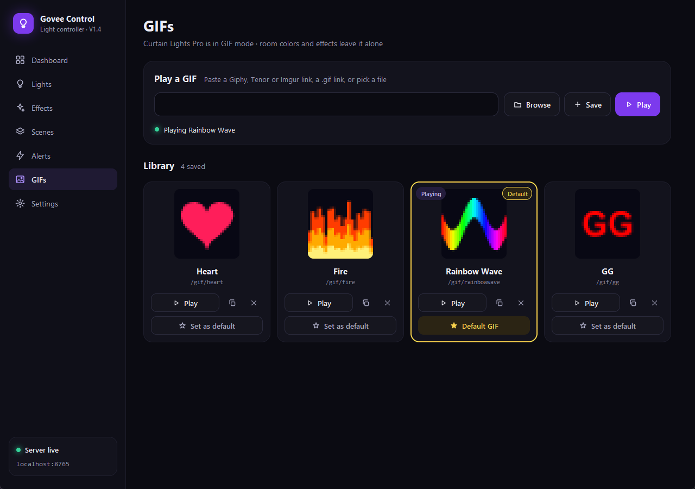
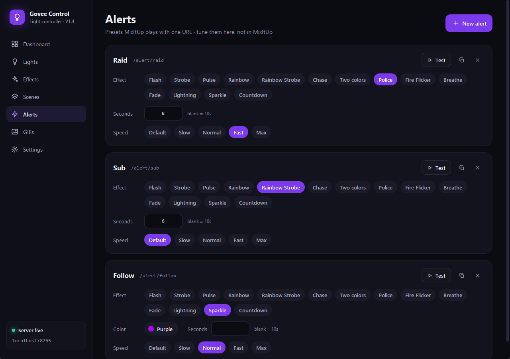
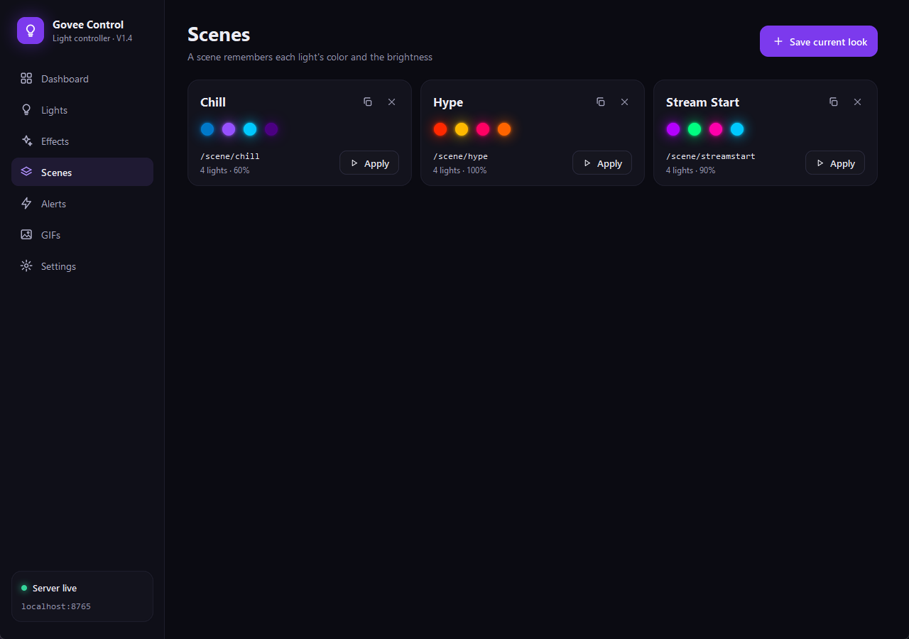

<p align="center"></p>
<h1 align="center">Govee Light Controller</h1>
<p align="center"><b>Your Govee lights, run by chat.</b><br>
Chat commands, channel points and alerts change your room the moment they happen,<br>
and your Govee Curtain Lights play GIFs your viewers send.</p>
<p align="center">
  <a href="https://github.com/TTV-VibesByVince/Govee-Lights-Controller/releases/latest"></a>
  <a href="https://github.com/TTV-VibesByVince/Govee-Lights-Controller/actions/workflows/ci.yml"></a>
  
  
  
  
  <a href="LICENSE"></a>
</p>

<p align="center"></p>
<p align="center"><sub>Recorded from the app itself with made-up lights and generated GIFs. Addresses are shown as <code>localip</code>.</sub></p>

A Windows app that sits quietly in the background and gives
[MixItUp](https://mixitupapp.com/) (or Streamer.bot, a Stream Deck, or anything
that can open a web address) a simple address for every light action:
`http://localhost:8765/red`, `/strobe/red`, `/alert/raid`, `/gif/hype`... The
lights react over your home network straight away, with no cloud involved and
no windows popping up.

<table>
  <tr>
    <td width="50%" valign="top">
      <h3>Setting it up?</h3>
      Download, double-click, scan for lights, paste a URL into MixItUp. No coding needed.<br><br>
      <a href="#install"><b>Install</b></a> · <a href="#using-it-with-mixitup">MixItUp URLs</a> · <a href="#setting-up-curtain-gifs">Curtain GIFs</a> · <a href="#faq">FAQ</a>
    </td>
    <td width="50%" valign="top">
      <h3>Curious how it works?</h3>
      Plain Python with one library, a local web server, Govee's LAN protocol, and how GIFs reach the curtain.<br><br>
      <a href="#how-it-works"><b>How it works</b></a> · <a href="CONTRIBUTING.md">Contributing</a> · <a href="CHANGELOG.md">Changelog</a> · <a href="ROADMAP.md">Roadmap</a>
    </td>
  </tr>
</table>

## Features

- **Colours:** 46 named colours (`/red`, `/hotpink`, `/gaming`...) or any hex colour (`/ff0080`).
- **Effects:** flash, strobe, pulse, rainbow, rainbow strobe, chase, police, two-colour alternate, fire flicker, breathe, fade, lightning, sparkle and countdown. Each runs for a set time or `/forever`, with optional speed, brightness and length.
- **Scenes:** save a colour for each light plus the brightness, and recall it with one URL.
- **Alert presets:** effect + colour + length + speed under one name, for raids, subs and follows. Alerts that arrive together play one after another.
- **Curtain GIFs:** paste a Giphy, Tenor or Imgur link, keep a library, set a default GIF that comes back after each chat GIF, queue GIFs from chat, and show viewers' Twitch or YouTube profile pictures as entrances.
- **Curtain mode:** a curtain can follow room colours like any other light, or stay in *GIF mode* where only GIF commands change it.
- **Dashboard:** every light at a glance, what is playing now, recent activity, and a copy button for every URL.

## Status

Version **1.4**. Runs on **Windows 10 and 11**. Tested with
Govee **H6076**, **H6062**, **H6042** and the **H70B6** Curtain Lights; any Govee light
with *LAN Control* should work for colours and effects.

## Install

> [!TIP]
> **Easiest:** download the zip from the [latest release](https://github.com/TTV-VibesByVince/Govee-Lights-Controller/releases/latest), unzip it anywhere, and double-click **Start Govee Controller.bat**. It installs the one library it needs the first time.

You need:

- **Python 3.10 or newer** from [python.org](https://www.python.org/downloads/). During setup, tick *Add python.exe to PATH*.
- **LAN Control turned on for each light.** In the Govee Home app, open each light's settings and switch on *LAN Control*. The PC and the lights must be on the same network.
- For curtain GIFs only: an internet connection, your Govee account and a free Govee developer API key ([see below](#setting-up-curtain-gifs)).

Or, with git:

```
git clone https://github.com/TTV-VibesByVince/Govee-Lights-Controller.git
cd Govee-Lights-Controller
pip install -r requirements.txt
python govee_controller_v1.4.py
```

The first time, click **Scan network** on the Dashboard to find your lights. If
Windows Firewall asks about Python, allow it on **private** networks, or the lights
can't be found.

## A look around

<table>
  <tr>
    <td width="50%"></td>
    <td width="50%"></td>
  </tr>
  <tr>
    <td><b>Dashboard.</b> Every light with its live colour, what is playing now with a countdown and a Stop button, quick colours, brightness and the activity log.</td>
    <td><b>Effects.</b> Thirteen effect tiles with a preview, speed control, <i>Run forever</i>, and a copy button for each MixItUp URL.</td>
  </tr>
  <tr>
    <td></td>
    <td></td>
  </tr>
  <tr>
    <td><b>Curtain GIFs.</b> Paste a link to play it, save favourites, and pick a default GIF (yellow border) that returns after chat GIFs.</td>
    <td><b>Alert presets.</b> One URL per event, with its effect, colour, length and speed set here instead of in MixItUp.</td>
  </tr>
  <tr>
    <td colspan="2" align="center"><br><b>Scenes.</b> Save the room's look, a colour for each light plus the brightness, and bring it back with one URL.</td>
  </tr>
</table>

## Using it with MixItUp

Add a **Web Request** action to a command and point it at one of these URLs. The
app's **Settings** page lists every URL with a copy button.

| What | URL |
|---|---|
| Colour | `http://localhost:8765/red` or `/ff0080` |
| Room on / off | `/on`, `/off` |
| Stop the effect, back to your default colour | `/stop` |
| Brightness | `/dim`, `/medium`, `/bright` |
| Strobe red for the effect duration | `/strobe/red` |
| Strobe until `/stop` | `/strobe/red/forever` |
| Rainbow strobe for 5 seconds | `/rainbow-strobe/5` |
| Other effects | `/chase/red`, `/police`, `/flicker`, `/breathe/blue`, `/lightning`, `/sparkle/purple`, `/fade/blue/3`, `/countdown/10` |
| Effect options | `/strobe/red?speed=fast&brightness=40&seconds=3` |
| Saved scene / alert | `/scene/chill`, `/alert/raid` |
| Wait for the running effect | `/queue/strobe/red` |
| One light | `/light/desk/red` |
| Status (JSON) | `/status` |

### Curtain GIFs from chat

| What | URL |
|---|---|
| A saved GIF | `/gif/hype` |
| Your default GIF | `/gif/default` |
| A link from chat, e.g. `!playgif <link>` | `/gif?url=$arg1text` |
| An entrance with the viewer's profile picture | `/gif/avatar?url=$useravatar` |
| Choose how long it stays | add `&seconds=15` |

Chat links are limited to Giphy, Tenor and Imgur, with a cooldown; both can be
changed in Settings. A GIF from a web request stays up for 8 seconds (adjustable),
then the next queued GIF or your default GIF takes over.

> [!NOTE]
> Other devices on your home network (a second PC, a NAS) can send these URLs too
> once **Settings > Accept requests from my network** is on. Requests from the
> internet are always refused.

## Setting up curtain GIFs

The LAN protocol can only set one colour per light, so pictures go through Govee's
cloud, the same way the Govee Home app does it.

1. **Get a Govee developer API key:** in the Govee Home app go to **Profile > Settings > Apply for API Key**. The key arrives by email.
2. **Connect:** in the app, open **Settings > Govee account**, enter the key, your Govee email and password, and click **Connect**. Govee may email you a verification code the first time.
3. **Pick the curtain's mode:** on the **Dashboard**, switch the curtain off to keep it in GIF mode (room colours and effects then leave it alone), or on to have it follow the room.
4. **Play:** on the **GIFs** page, paste a link and press **Play**, or **Save** it to the library and mark one as the default.

Sending a GIF takes about 5 seconds.

> [!WARNING]
> Curtain GIFs use the Govee Home app's private, undocumented interface. Govee can
> change it at any time, and it may not be covered by Govee's terms of service.
> Everything else in the app uses Govee's official LAN protocol.

## FAQ

<details>
<summary><b>Which lights work?</b></summary>

Any Govee light that has *LAN Control* in the Govee Home app. It's been tested with
the H6076, H6062, H6042 and H70B6. GIFs only work on Curtain Lights (H70B6).
</details>

<details>
<summary><b>Does it work with Streamer.bot, a Stream Deck or OBS?</b></summary>

Yes. The app only needs something that can open a web address. In Streamer.bot use
*Fetch URL*; on a Stream Deck use a website or web request action.
</details>

<details>
<summary><b>Why do GIFs need the internet when nothing else does?</b></summary>

Govee's LAN protocol can only set one colour for a whole device. Pictures have to be
uploaded through Govee's cloud, the way the Govee Home app does it.
</details>

<details>
<summary><b>Is it safe to let chat send GIF links?</b></summary>

By default only Giphy, Tenor and Imgur links are accepted, with a 10-second cooldown,
and a GIF from chat goes back to your default after 8 seconds. Those sites are
moderated, but you may still want the command limited to subscribers or mods in
MixItUp.
</details>

<details>
<summary><b>Where are my settings, and how do I uninstall?</b></summary>

Everything lives in the app's folder: `govee_config.json` (lights and settings),
`govee_account.json` (Govee sign-in, encrypted for your Windows user) and `gifs/`.
To uninstall, delete the folder.
</details>

<details>
<summary><b>Does it run on a Mac or Linux?</b></summary>

It's written in portable Python, but it has only been tested on Windows, and the
encrypted sign-in storage is Windows-only.
</details>

## Troubleshooting

- **No lights found:** check that LAN Control is on for each light in the Govee Home app, that the PC is on the same network, and that the firewall allowed Python on private networks.
- **"Server offline" in the sidebar:** another copy of the app (or another program) is using port 8765. Close it, or change the port in Settings.
- **Nothing happens when double-clicking the launcher:** open a command prompt in the folder and run `python govee_controller_v1.4.py` to see the error.
- **GIFs stopped working:** run `python tools/curtain_test.py` for a step-by-step report of the Govee side.

## How it works

```
MixItUp ──web request──▶ this app (http://localhost:8765) ──LAN (UDP)──▶ room lights
                               │
                               └──Govee cloud (HTTPS)──▶ Curtain Lights (GIFs only)
```

- **One library:** plain Python 3.10+ and [Pillow](https://python-pillow.org/), nothing else. The interface is tkinter, with every rounded corner, glow and icon drawn by Pillow.
- **Lights over the LAN:** found by a multicast scan, then controlled with Govee's LAN protocol (UDP port 4003).
- **Curtain GIFs:** each GIF is cropped and shrunk to the curtain's 30×32 LEDs, reduced to 256 colours, uploaded as a temporary DIY effect, played, then deleted from your account.

| File | What it does |
|---|---|
| `govee_controller_v1.4.py` | Starts the app |
| `engine.py` | Settings, colours, finding lights, the effects |
| `server.py` | The web server and every URL |
| `curtain.py` | Govee sign-in, GIF conversion and upload |
| `ui/` | The interface, one file per page |
| `tests/` | Offline tests, run on every push |
| `tools/curtain_test.py` | Diagnoses the Govee side on its own |

### Privacy

- **No telemetry:** the app doesn't track or report anything.
- **Local by default:** the web server only answers this PC unless you allow your home network, and never answers the internet.
- **Govee only for GIFs:** the only outside service the app talks to is Govee, and only for curtain GIFs.
- **Encrypted sign-in:** your API key and sign-in are encrypted for your Windows user. The password is kept (also encrypted) only if *Stay signed in* is on, and is only ever sent to Govee.

## Contributing

Bug reports, ideas and pull requests are welcome. See [CONTRIBUTING.md](CONTRIBUTING.md),
the [roadmap](ROADMAP.md) and the [changelog](CHANGELOG.md). To report a security
problem, see [SECURITY.md](SECURITY.md).

## Credits and license

Thanks to **tailgunner357**: the curtain GIF upload method, including the fixed data
block in `curtain_chunk1.txt`, comes from his *Govee GIF Player* and is used with his
permission.

This is an unofficial project, not affiliated with or endorsed by Govee.

Released under the [MIT License](LICENSE).
